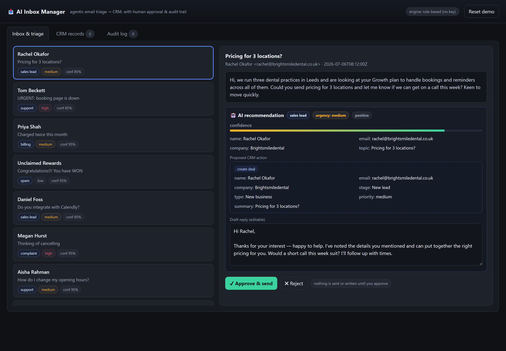
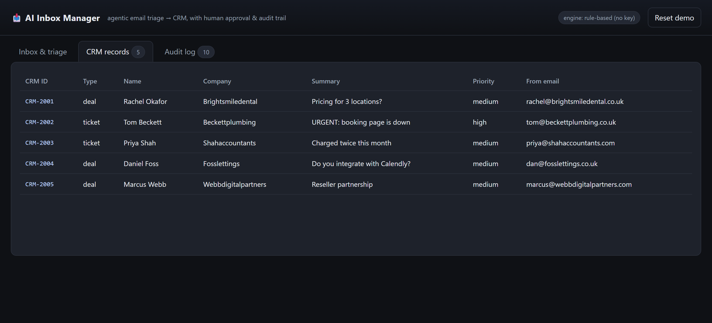
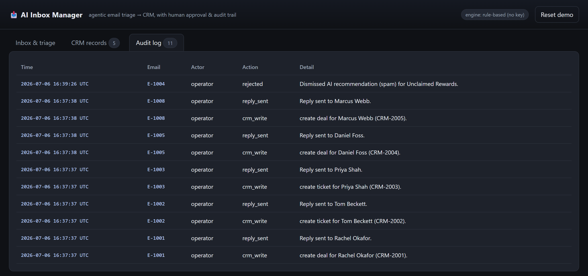

# AI Inbox Manager

An agentic assistant that triages a shared inbox and turns each email into the
**right next action** — a drafted reply plus a structured CRM record — while a
human approves everything before it's sent or written. Built as a portfolio
demonstration of AI automation with a **human-in-the-loop** and a full **audit trail**.


## Screenshots
| Triage + approval | CRM records written on approval |
|---|---|
|  |  |

**Append-only audit trail** — every approval, CRM write, reply, and rejection is logged:



## Why it matters
Small businesses lose hours to inbox triage — and lose leads when a hot enquiry
sits unread behind spam and FAQs. This assistant reads every incoming email and, for each one:

1. **Classifies** intent (sales lead, support, billing, complaint, partnership, spam…) and **urgency**.
2. **Extracts** the structured data — name, company, contact, topic, sentiment.
3. **Drafts** a warm, on-brand reply.
4. **Proposes a CRM action** — create a *deal*, a *ticket*, or a *contact* — never invented, always shown for review.

Then it **stops**. Nothing is sent and nothing is written until a human clicks
**Approve** (or edits, or rejects). Every decision lands in an append-only audit log.

That last part is the point: for anything customer-facing, "the AI did it automatically"
is a liability. "The AI did the work, a human approved it, and here's the record" is a system a
business can actually trust.

## Run it locally
```bash
pip install -r requirements.txt
uvicorn app.main:app --reload --port 8020
# open http://localhost:8020
```
Runs out of the box with **no API key** (transparent rule-based triage). Add a key
for live Claude triage:
```bash
pip install anthropic
export ANTHROPIC_API_KEY=sk-ant-...
# restart — the engine badge flips to "Claude (live LLM)"
```

## How it works
| File | Role |
|---|---|
| `app/agent.py` | the triage agent — classify · extract · draft · propose CRM action (Claude, or rule-based fallback) |
| `app/data.py`  | synthetic inbox + in-memory CRM / audit state |
| `app/main.py`  | FastAPI: inbox, approval queue, CRM writes, audit log |
| `app/static/index.html` | the operator console UI |

The agent only ever **recommends**. Approval, CRM writes and the audit log all live
on the server side, gated behind the human decision — the same shape you'd wire to a
real Gmail/Outlook inbox and a real HubSpot/Notion/Airtable CRM.

## Data & privacy
Ships with **fabricated** sample emails only — no real people, no real mailbox, nothing
stored beyond the running process. Swap `app/data.py` for a real mail source and CRM
client to take it live.

## Stack
Python · FastAPI · vanilla-JS console · (optional) Anthropic Claude.

---
*Demonstration build — not a paid client engagement. All inbox data is synthetic.*
